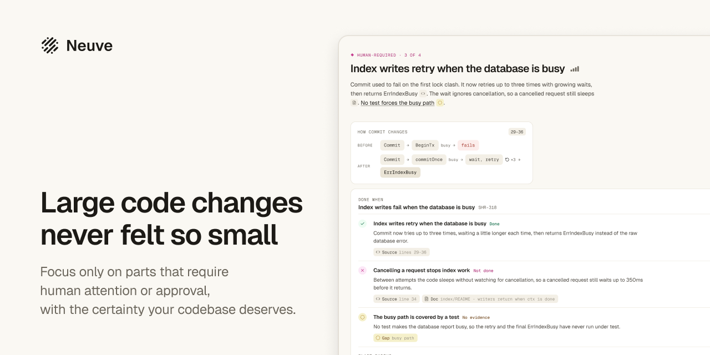

# Neuve

[](LICENSE)

**Large code changes never felt so small**

Focus only on parts that require human attention or approval, with the certainty your codebase deserves.

<picture>
  <source media="(prefers-color-scheme: dark)" srcset="./design/brand/assets/social/readme-hero-dark.png">
  <source media="(prefers-color-scheme: light)" srcset="./design/brand/assets/social/readme-hero-light.png">
  
</picture>

> [!NOTE]
> Neuve is early. Expect rough edges and changing commands.

Neuve is open-source code review, MIT-licensed, for code that agents write. Give it a commit range. It states what the change is for and splits it into batches, and each batch into smaller parts. Four agents look for problems (scope fit, correctness, risky edges and tests), and each finding is checked again in a fresh context before you see it. Each batch's summary says why the batch exists and links findings to the parts that hold them, and each finding cites the code it rests on. The diff is there whenever you want to read it, and you record your review in the review desk. Today it runs on your machine, and model calls go to the provider you set up. Neuve posts no reviews or comments to GitHub.

How agents and people share the work: Neuve is designed to put each part of a change in one of four review lanes. Agents decide agentic work. On human-suggested work, a decision the agents have made stands unless a person steps in, and human-required work waits for a person. Today's runs put every part in human-suggested, and the agents only request changes or comment, so each part still comes to a person.

## Why

I started out building agents for QA, and soon saw that teams weren't stuck on QA. They were stuck on code review. I wanted large changes to stop being something to be overwhelmed by or afraid of: a review that filters out the parts people aren't required to see, and attaches the right information to the parts that matter. I've been building Neuve for almost a year to be that review.

## Quick start

One line installs the `neuve` command on Macs with Apple silicon, on Linux with glibc 2.34 or later (x64 and arm64), and on Windows through WSL.

```sh
curl -fsSL https://neuve.ai/install.sh | sh
```

Reviews run on your own model account: an Anthropic API key or a ChatGPT subscription. To use an Anthropic API key, put it in the shell you run `neuve review` in:

```sh
export ANTHROPIC_API_KEY=...
```

Reviews use the Anthropic route by default. To use a ChatGPT subscription instead, set `review.route` to `openai` in your [review settings](apps/neuve-cli/SETUP.md#review-settings), then sign in:

```sh
neuve auth login openai
```

Run `neuve setup` in your repository. It ends by checking that your provider's key or sign-in is available. `neuve doctor` names anything that's missing and how to fix it.

```sh
cd /path/to/your/repository
neuve setup
```

In the same repository, point Neuve at a commit range, then open the review in the review desk:

```sh
neuve review main..my-branch
neuve review desk
```

`neuve review` starts a review and follows its run. A background worker runs the review, so closing the terminal doesn't stop it. Without `neuve setup`, `neuve review` and `neuve review desk` stop and print the setup command to run. `neuve review desk` prints the desk's address, such as `http://127.0.0.1:4141/`. The desk stays open until you press Ctrl-C. While it's open, `neuve review` also prints a link to the review. The [CLI guide](apps/neuve-cli/SETUP.md) covers everything else `neuve` does in a repository.

### Upgrade and uninstall

```sh
neuve upgrade
curl -fsSL https://neuve.ai/install.sh | sh -s -- --uninstall
```

`neuve upgrade` installs the latest release. To install a given release, add its tag, such as `neuve upgrade --version v0.1.0`. The second line uninstalls Neuve.

### If an install was cut off

If you close the terminal or press Ctrl-C during an install, upgrade or uninstall, the installer puts the previous version back. Run the same command again.

If the machine lost power or the install was stopped with `kill -9`, the next run may stop with "Another install holds …/.install.lock". The folder is in your install folder, `~/.neuve` by default. If none is running, delete that empty folder. Then run the same command again, adding `--force` after `sh -s --`:

```sh
rmdir ~/.neuve/.install.lock
curl -fsSL https://neuve.ai/install.sh | sh -s -- --force
curl -fsSL https://neuve.ai/install.sh | sh -s -- --uninstall --force
```

The second line is for an install or upgrade, and the third for an uninstall. After an upgrade, use the install line above, because `neuve upgrade` has no `--force`.

If you installed into another folder with `NEUVE_INSTALL_DIR`, delete `.install.lock` in that folder instead. The installer's message gives the lock's full path, so you can copy it from there. Keep `NEUVE_INSTALL_DIR` set when you run the command again. Without it, the installer uses `~/.neuve`.

`--force` also lets the installer replace a copy built from source. Use it only when no other install is running.

Each user account has one launchd agent on macOS, or one systemd timer on Linux, that starts background workers. If you install into two folders, the install that finishes last takes it over. Running two installs into different folders at the same time isn't supported.

### Working on Neuve itself

To build Neuve from source or work from a checkout, see [CONTRIBUTING.md](CONTRIBUTING.md).

## How it works

```
commit range ─▶ goal, batches and parts ─▶ four agents look for problems ─▶ each finding checked again ─▶ you record your review in the review desk
```

| Step | What happens |
| --- | --- |
| Goal, batches and parts | Neuve states the change's goal and what done means, from the ticket or plan it can fetch, and says when there isn't one. Each changed line belongs to one part, even when a run is cut off |
| Looking for problems | Scope fit says whether the change meets what done means, or that a person must judge it. Correctness follows the changed code to a failure you could see. Risky edges checks data, auth and interfaces such as exports, config and wire formats. Tests checks whether tests or other proof show what done means |
| Checking | The check runs against evidence that Neuve's code gathers, with no lookup tools for the model. A finding that couldn't be checked is counted, never shown as a comment |
| Your call | From the overview of a batch, open one of its parts. The checked findings sit beside the lines they're about, and you record your review in the review desk |

The [product vocabulary](vocabulary.md) defines Neuve's terms, including the review unit, its name for a part, and the [architecture overview](architecture/README.md) describes the six layers behind them: harness, system of records, graph, CLI, MCP and web app.

## Documentation

- [Contributing](CONTRIBUTING.md): building Neuve from a checkout, the contributor check and how review works
- [CLI guide](apps/neuve-cli/SETUP.md): installing Neuve in a repository and everything `neuve` does there
- [Architecture](architecture/README.md) and its records: how the system is built, and why
- [Packages](CONTRIBUTING.md#packages): the repository's packages and what each one is
- [Product vocabulary](vocabulary.md) and [foundations](foundations): what Neuve's terms and ideas mean
- [Design decisions](process/decisions.md): Neuve's product decisions, which override older text

## Contributing

Neuve is built by coding agents under independent review, and contributions go through the same review. [Contributing](CONTRIBUTING.md) explains how to propose a change, how review works and what a pull request needs. Please read the [code of conduct](CODE_OF_CONDUCT.md), and report security problems privately as the [security policy](SECURITY.md) describes.

## Credits

Neuve's host and channel packages (`@ace/host` and `@ace/channel`) are adapted from GitHub Next's [Ace](https://github.com/githubnext/ace), and Neuve Graph is a fork of [Entire Graph](https://github.com/entireio/entire-graph). Both are MIT-licensed. The review desk's diffs render with a modified copy of Pierre's [`@pierre/diffs`](https://github.com/pierrecomputer/pierre) (Apache-2.0). The notices for all three are kept in the repository.

Other third-party components, icons and fonts keep their own licenses. Some packages list them in a notice, such as the web app's interface package ([`apps/neuve-web/packages/ui`](apps/neuve-web/packages/ui/NOTICE.md)).

## License

[MIT License](LICENSE) · Copyright (c) 2026 Neuve AI
