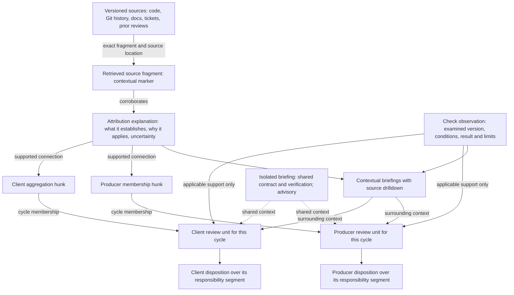
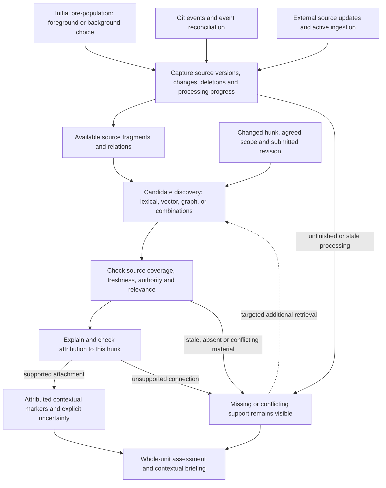
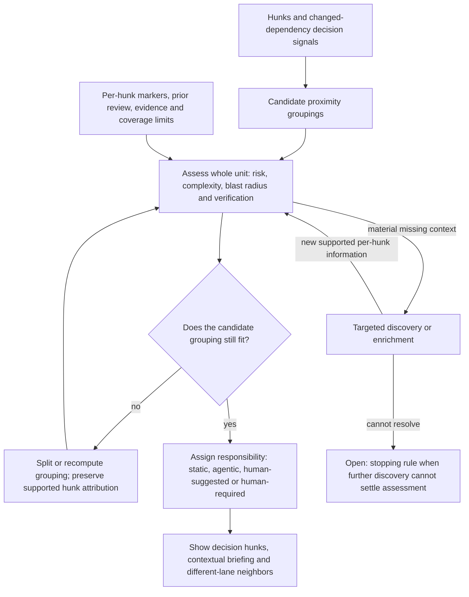
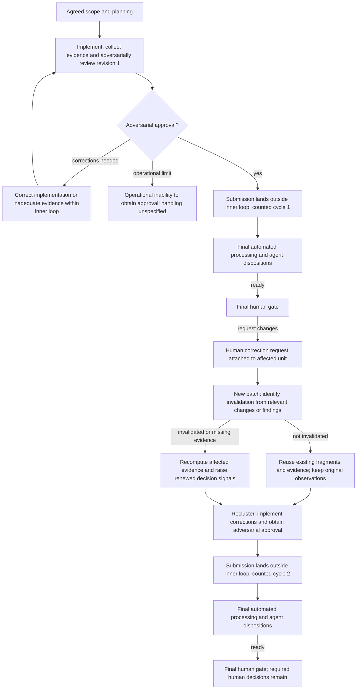

# Four views of the worked review

Status: conceptual design exploration, 2026-09-20. These diagrams explain the [mixed-tier repair](worked-review.md). They combine accepted relationships with proposed processing steps; neither boxes nor arrows select a graph schema, storage system, or algorithm. Example unit names refer to hunk groupings, not permanent product identities.

Rendered copies: [information and attribution](evidence/diagram-1.png), [retrieval and ingestion](evidence/diagram-2.png), [assessment and reclustering](evidence/diagram-3.png), and [evidence across cycles](evidence/diagram-4.png).

## 1. Information and attribution

The accepted [unit and context foundation](../foundations/04-review-units-and-context.md) separates the hunks receiving a decision from information used to make it. In this example the same producer fragment supports both producer and client hunks. The representation of those links remains open.

The marker remains a source fragment. The attribution explanation and generated briefing are interpretations linked to it. A different-lane neighboring hunk may be shown as a read-only neighbor while retaining its own responsibility. Prior approval alone does not make something a read-only neighbor. The isolated briefing has no approval arrow because it adds no disposition requirement.

## 2. Retrieval, attribution, and ingestion

The three ingestion routes and incomplete-processing disclosure are [established requirements](../foundations/08-ingestion-and-setup.md). The common processing, refresh, and filtering boxes are a proposed logical decomposition. Search and graph alternatives are compared in the [retrieval analysis](retrieval-comparison.md#compare-the-candidates-on-the-same-change).

Users can work while initial processing is incomplete. Proposed source-level progress would explain which material is available and which remains unprocessed. A completed query over incomplete sources is still incomplete evidence. A duplicate event should not create independent corroboration. An updated ticket must not silently change what a historical review cited.

## 3. Whole-unit assessment and reclustering

Markers attach to hunks; assessment uses the unit's whole surrounding context. That distinction and the possibility of splitting/recomputing clusters are [accepted](../foundations/06-escalation-and-decomposition.md). The feedback mechanism and stopping condition below remain design questions.

In the example, discovering that hidden members affect the branch verdict changes the producer unit's surrounding context. It does not automatically assign a human lane or permit de-escalation. Further evidence can change assessment in either direction. No weight, certainty scale, universal marker gate, or iteration limit is selected. Separate units keep separate dispositions even when a briefing explains their shared dependency.

## 4. Evidence and decisions across cycles

This is the [worked example's simulated sequence](worked-review.md#walk-the-example-through-the-workflow), not a historical timeline. The accepted [cycle boundary](../foundations/02-review-modes-and-cycles.md#cycle-boundary-and-corrections) counts external submissions, not inner correction attempts. Exact partial/concurrent submission counting remains open.

The diagram follows one human-correction path. Final automated reviewers can also request corrections, returning work to implementation and adversarial review. Their later external resubmission would be another counted cycle, not another pass through an unchanged cycle number. Partial and concurrent submission rules remain open.

The fallback change needs fresh behavioral evidence. An unchanged aggregation hunk can remain context when its outcome is unaffected. If a changed producer alters that outcome, the client needs renewed attention even without a textual change. Reuse existing valid evidence and context unless invalidated, as required by the [no-repetition principle](../foundations/05-reviewers-tax.md#established-principle). A new commit alone does not require a fresh applicability proof.

Within the development loop, agents [query surrounding context and reason against pinned task scope](../foundations/02-review-modes-and-cycles.md#context-for-agent-reasoning). Conflict resolution belongs mostly to their workflow, supported by Neuve's context aggregation. The exception box concerns operational inability to obtain approval, whose handling remains unspecified. It does not imply an approval bypass or routine human-scoping exit.
