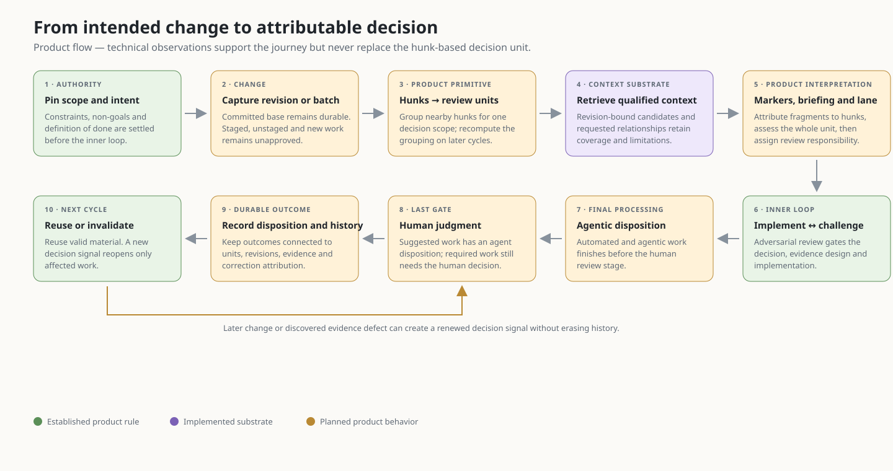
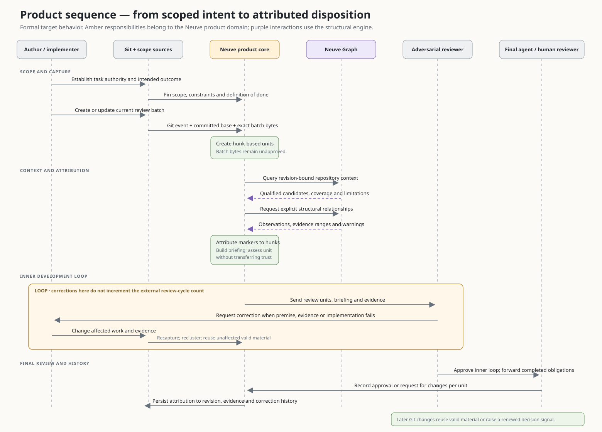
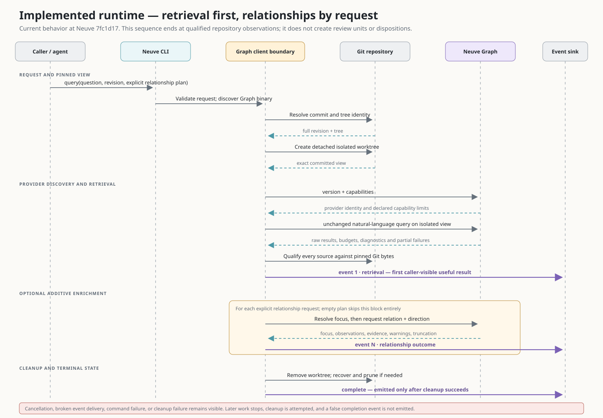
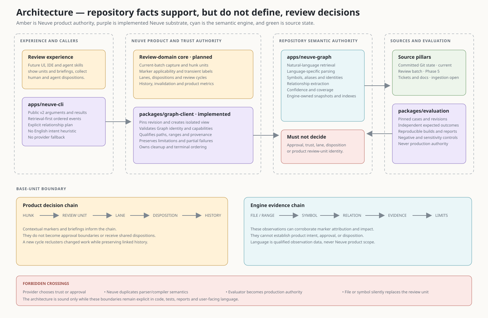

# Neuve development snapshot — 2026-09-30

Status: point-in-time product and architecture audit. This report does not resume the paused implementation plan or replace the transient handover.

## Snapshot identity

- **Neuve source:** `7fc1d1743bb9c1fa3ff865acc1c3a68464de29fc` on `main`.
- **Neuve Graph source:** `ad83a27a7859656f8d30a9234d3787f3c38d742b` on its `main` branch.
- **Observed pre-report worktree:** only the user-owned `HANDOVER.md` was modified; Neuve Graph was clean.
- **Execution state:** the migration goal was paused at the user's request. The interrupted latest external-suite attempt has no valid canonical result.
- **Evidence window:** repository sources, accepted foundations, decision records, current code, and checks rerun on 2026-09-30. No production telemetry, product analytics, or current user-study evidence was available.

## Executive judgment

**Established and supported:** the product direction remains coherent. The vocabulary, review-flow foundations, structural-engine ownership, and retrieval-first boundary reinforce one another.

**Implemented and verified:** Neuve currently provides a trustworthy repository-query substrate. It pins a committed revision, qualifies Graph output, emits retrieval before optional requested relationships, preserves limitations, and cleans its isolated view before completion.

**Partial:** that substrate does not yet constitute the review product. The hunk-to-review-unit workflow, current-batch overlay, attributed briefing, routing, disposition, human gate, history, and invalidation behavior remain largely specified rather than runnable.

**Drift risk:** Graph correctness work is ahead of the user-facing review journey. More engine work is justified only by the remaining frozen obligations. After that measurement, the next slice should close an end-to-end product gap rather than deepen the substrate by default.

## Product model and first principles

The [accepted product purpose](../../foundations/01-product-purpose.md) is to help humans and agents turn intended changes into verifiable work, preserve why decisions were made, and concentrate human judgment on unresolved parts without reconstructing all preceding work.

The [product vocabulary](../../vocabulary.md) makes the key units explicit:

- A **hunk** is the closest base unit of changed work.
- A **review unit** is a proximity-based grouping of hunks for one decision scope in a particular cycle.
- A **contextual marker** is a traceable fragment attributed to a hunk; it informs the unit but is not the unit or its decision.
- A **disposition** is the approval or request for changes attached to the applicable review unit.
- A **review cycle** is counted after units leave the inner implementer/adversarial-reviewer loop.
- The **committed graph** is durable history. The **current review batch** is staged, unstaged, and newly added work under review.
- **Transient context** can explain a sibling unit in the same batch, but remains visibly unapproved and cannot transfer disposition.

The governing invariants are:

1. Commit and staging create identity or preparation state, not approval.
2. Context can inform multiple units without sharing their decisions.
3. Relevant overlap is not repetition; resolved work is reused until a supported reason invalidates it.
4. Unchanged text can need renewed review when dependencies or outcomes change.
5. A graph observation or passing check supports only what it actually observed.
6. Files, symbols, ranges, and relationships are evidence ingredients; they must not replace hunk-based review units as the product primitive.

## Intended user flow

The [review-unit rules](../../foundations/04-review-units-and-context.md) and [review sequencing rules](../../foundations/02-review-modes-and-cycles.md) establish this flow. The first two substrate segments—revision-bound retrieval and explicit relationship enrichment—are runnable. The later review-product segments are not yet an end-to-end implementation.

## Product review sequence

This sequence distinguishes two loops. Corrections within the implementer/adversarial-reviewer loop do not increment the review-cycle count. A request for changes after work reaches final review returns the affected unit through implementation and later creates another external submission.

## Current runtime sequence

The runtime stops at qualified repository observations. It does not imply that Neuve has created review units or dispositions. The implementation is anchored in the [public v2 query event union](../../apps/neuve-cli/src/domain.ts) and the [managed Graph inspection lifecycle](../../packages/graph-client/src/index.ts).

## Architecture and ownership

The [accepted monorepo ownership plan](../../process/monorepo-restructure.md) establishes one authority per concern:

- `apps/neuve-graph` owns repository retrieval and all language-specific structural semantics.
- `packages/graph-client` owns the validated executable boundary, revision isolation, provenance qualification, limitations, and cleanup.
- `apps/neuve-cli` owns the current public query contract and event representation.
- Neuve's future review-domain core owns current-batch semantics, hunk-based units, contextual applicability, lanes, dispositions, cycles, and metrics.
- `packages/evaluation` owns pinned cases and independent expected outcomes; it is not production authority.

The hard architectural boundary is symmetrical: Graph cannot decide product trust, approval, or review-unit identity, and Neuve cannot grow a parallel parser, compiler, language server, or structural engine.

## Scope versus runnable reality

| Product concern                | Accepted scope                                                                                                | Current state                                       | Sanity implication                                                             |
| ------------------------------ | ------------------------------------------------------------------------------------------------------------- | --------------------------------------------------- | ------------------------------------------------------------------------------ |
| Review primitive               | Hunks grouped into revisable review units                                                                     | **Open:** foundations and cases only                | The central product object is not runnable yet.                                |
| Repository context             | Durable committed graph plus transient current-batch overlay                                                  | **Partial:** committed revision queries exist       | Phase 5 is the first direct bridge from substrate to product model.            |
| Retrieval                      | Selective, attributable context distinct from proof                                                           | **Implemented:** revision-bound Graph retrieval     | The boundary matches the accepted research distinction.                        |
| Relationship enrichment        | Explicit, optional, additive structural observation                                                           | **Implemented:** upfront plan and ordered events    | Retrieval is no longer blocked by an unconditional `CALLS` drilldown.          |
| Repository-language neutrality | Provider capability and observation data, not product policy                                                  | **Implemented at the boundary**                     | The discarded parallel TypeScript verifier has not returned.                   |
| Evidence integrity             | Identity, provenance, coverage, limitations, and negative controls                                            | **Implemented strongly in the substrate**           | These checks establish source integrity, not review-product quality.           |
| Marker attribution             | What a fragment establishes, why it applies to a hunk, and what remains uncertain                             | **Open:** no hunk applicability model               | Retrieval rank must not silently become attribution or routing policy.         |
| Review lanes and dispositions  | Four lanes; every non-static obligation receives a disposition                                                | **Open:** product rules only                        | No decision workflow exists yet.                                               |
| Inner review loop              | Decision, evidence, and implementation gates                                                                  | **Partial:** used to build Neuve                    | The process has local evidence; product orchestration remains absent.          |
| Human experience               | Briefings, suggested/required distinction, final gate                                                         | **Open:** legacy references and designs             | The redesigned user experience has not been validated.                         |
| Reuse and invalidation         | Reuse unless invalidated; preserve connected history                                                          | **Open:** principle accepted, mechanism unspecified | Identity and invalidation propagation remain core design work.                 |
| Ingestion                      | Initial history plus Git-led ongoing events and external source pillars                                       | **Open:** direction only                            | Isolated queries are not the durable committed graph described by the product. |
| Persistence and indexing       | Decide after measured obligations and cost                                                                    | **Correctly deferred**                              | Storage work now would outrun the product and invalidation model.              |
| Product benefit                | Reduce wrong/missing attribution and unnecessary repetition while preserving quality at acceptable token cost | **Unknown:** no production measurement              | Local correctness cannot establish the product promise.                        |

## Correctness and validation

Checks rerun against the revisions in this snapshot:

| Check                               | Result                                                      | What it establishes                                                                                | What it does not establish                                      |
| ----------------------------------- | ----------------------------------------------------------- | -------------------------------------------------------------------------------------------------- | --------------------------------------------------------------- |
| Root `bun test`                     | 134 tests passed; 301 assertions                            | CLI, graph boundary, evaluator, workspace, language-neutrality, cleanup, and failure-path behavior | Retrieval usefulness or a complete review workflow              |
| Root typecheck                      | Passed                                                      | Current TypeScript surfaces typecheck                                                              | Runtime semantics or product validity                           |
| Root formatting check               | Passed                                                      | Tracked source follows current formatting rules                                                    | Architectural correctness                                       |
| CLI build                           | Passed                                                      | The current public binary compiles                                                                 | Installability on every target platform                         |
| Graph `go test ./...`               | Passed, including the long semantic package                 | Current Graph source passes its repository tests                                                   | The frozen external `neuve_effect` cases at the parent revision |
| Graph `go vet ./...`                | Passed                                                      | Go static checks reported no findings                                                              | Runtime or retrieval completeness                               |
| Historical complete external suites | Reproducible and byte-identical at their recorded revisions | Runner integrity, prior revision identities, and recorded red/green stage outcomes                 | Current Graph `ad83a27` case-wide outcome                       |
| Latest external rerun               | Interrupted after one complete attempt; no canonical report | Nothing beyond partial diagnostic activity                                                         | Current external-suite acceptance                               |

The most important evidence distinction is therefore current: local Neuve and Graph gates are green, while the latest full external measurement for Graph `ad83a27` is incomplete.

## Gaps, risks, and competing readings

### Known gaps

- No production telemetry or analytics measures wrong attribution, missing attribution, repetition, regressions, or token cost.
- No current user study validates the proposed briefing, lane visibility, or human gate.
- No implemented identity model carries hunks and units across patches, renames, splits, merges, or branches.
- No implemented invalidation mechanism propagates a changed dependency or evidence defect.
- No completed external report measures the latest Graph ranking change at the committed parent revision.

### Competing readings

1. **The engine work is necessary foundation work.** This is supported where each change closes a frozen external obligation and preserves one semantic owner.
2. **The engine work is becoming product drift.** This becomes the stronger reading if new engine work is added without a failed accepted case while review units, briefings, and dispositions remain absent.

The next external measurement distinguishes whether the current engine obligation is closed. It cannot answer whether the review product is useful; only a product slice and its user/economic measures can do that.

## Next gates

### Gate 1 — complete current external remeasurement

- **Product gap closed:** none directly; this closes the current substrate evidence gap.
- **Boundary:** existing evaluator, Neuve `7fc1d17`, Graph `ad83a27`.
- **Exit evidence:** two complete canonical attempts, cleanup, preserved red outcomes, and exact current source identities.
- **Deferred:** no evaluator weakening, new retrieval heuristic, persistence, or public schema change.

### Gate 2 — implement committed base plus current-batch capture

- **Product gap closed:** Neuve can observe the actual work under review without presenting it as committed or approved.
- **Boundary:** Neuve owns batch identity and trust labels; Graph supplies repository observations.
- **Exit evidence:** the frozen isolation, stale-content, abandonment, staging, lineage, and no-disposition-transfer controls.
- **Deferred:** general ingestion infrastructure and long-term persistence.

### Gate 3 — deliver one review-unit vertical slice

- **Product gap closed:** a user can move from a current batch to hunks, one review unit, attributed context, and one independent disposition.
- **Boundary:** review-domain core plus the existing qualified Graph boundary.
- **Exit evidence:** a user-visible path proving what receives the decision, what is contextual only, and how same-batch transient context is labeled.
- **Deferred:** universal routing scores, every lane, broad UI polish, adaptive sessions, and general graph storage.

### Gate 4 — measure the product claim

- **Product gap closed:** Neuve can test whether the slice reduces reviewer's tax without hiding quality loss.
- **Boundary:** evaluation and product telemetry, not Graph ranking alone.
- **Exit evidence:** explicit denominators for wrong attribution, missing attribution, unnecessary repetition, regressions, and input/output tokens.
- **Deferred:** claims of time saved or organization-wide return on investment.

## Source register

- The [repository constitution](../../CONSTITUTION.md) establishes contextual linkage, repository-language neutrality, and rendered visual explanation.
- The [product vocabulary](../../vocabulary.md) defines the review units, context, responsibility, history, and economic terms used in this report.
- The [product purpose](../../foundations/01-product-purpose.md) establishes the user promise and measurement commitments.
- The [review sequencing foundation](../../foundations/02-review-modes-and-cycles.md) establishes planning, inner-loop, final-review, and human-gate boundaries.
- The [unit-history foundation](../../foundations/03-unit-history-and-metrics.md) establishes attribution before aggregation and quality/token priorities.
- The [review-unit foundation](../../foundations/04-review-units-and-context.md) establishes hunk-based units, current-batch semantics, reclustering, and independent dispositions.
- The [reviewer's-tax foundation](../../foundations/05-reviewers-tax.md) establishes reuse unless invalidated and distinguishes useful overlap from repetition.
- The [escalation foundation](../../foundations/06-escalation-and-decomposition.md) establishes lanes and whole-unit assessment while leaving exact algorithms open.
- The [verification foundation](../../foundations/07-verification-and-evidence.md) establishes scoped evidence and adversarial responsibility for invalid evidence.
- The [ingestion foundation](../../foundations/08-ingestion-and-setup.md) establishes Git-led durable ingestion and separate current-batch capture.
- The [structural-engine foundation](../../foundations/09-structural-engine.md) establishes the Graph fork and sole semantic-owner boundary.
- The [structural-engine execution plan](../../process/structural-engine-plan.md) records completed phases, current obligations, and deferred persistence.
- The [research source audit](../../process/research-audit.md) distinguishes source facts, historical implementation, vendor claims, and unmeasured product benefit.
- Current implementation anchors are the [public CLI domain](../../apps/neuve-cli/src/domain.ts), [public Graph adapter](../../apps/neuve-cli/src/graph-query.ts), and [validated Graph lifecycle](../../packages/graph-client/src/index.ts).

## Confidence

Confidence is high for the accepted product rules, current source layout, runtime event ordering, ownership boundaries, and local verification results because they are directly documented or rerun. Confidence is moderate in the “substrate drift” risk because it is an architectural interpretation of the imbalance between implemented packages and unimplemented product units. Product benefit remains unknown because the repository contains no production or current user evidence that measures it.
