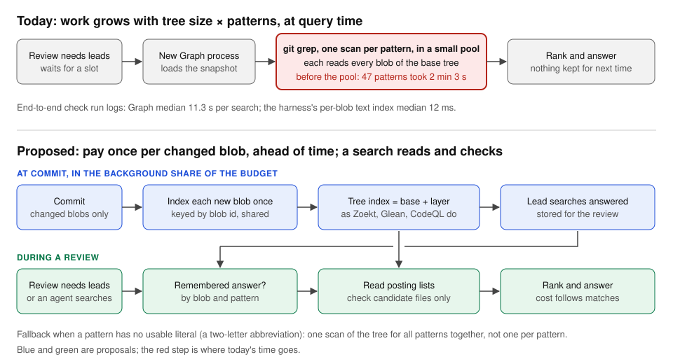

# Local code search under a machine-wide budget

Research date: 23 October 2026. Status: research and proposals; nothing here is built or ruled. It answers the owner's ask of 23 October: how other local code-search and graph tools stay fast, what they compute ahead of time, how they share a machine's CPU, and what would stop Neuve Graph's searches from being a bottleneck. It builds on the accepted [machine-wide budget design](../process/proposals/machine-budget.md) and the [harness decisions of 21 October](../process/decisions.md#area-10-harness-m3-18-october-2026) (heavy work within one budget, work computed once, ahead-of-time work from git hooks, measurement through telemetry). The source notes (kept in the private archive) hold what each outside source says, with its figures.

## In short

A Graph search is slow because it does work proportional to *the whole base tree times the number of patterns*, at query time, in a fresh process, and nothing it learns is kept. Every serious code-search tool avoids exactly that: either it scans once for all patterns (ripgrep), or it builds an index ahead of time so that a query reads a few posting lists and checks only the candidate files (Russ Cox's codesearch, Zoekt, GitHub's Blackbird, Cursor's local regex index). The ones that stay fresh do so by indexing per file or per blob and stacking a small change layer on a base (Blackbird's blob-keyed shards, Zoekt's delta shards, Glean's stacked databases, CodeQL's overlay databases, Cursor's commit-anchored index).

Neuve already does this for its own text search: the harness's BM25 index is cached per blob and assembled per tree, and answered 1,497 searches in the end-to-end check at a median of 12 ms. Graph answered 3 at a median of 11 s. The gap is not the machine; it is that Graph keeps a prepared symbol graph per commit but no text index, so it still finds candidate files by scanning.

The recommended order, cheapest first: carry Graph's own timings into telemetry; scan the tree once for all of a query's patterns; remember each blob's answer per pattern; take Graph's lead searches off the review's waiting path by running them at commit time; serve agents' identifier lookups from the index the harness already has; then build a text index into Graph's prepared snapshot. A shared Graph service for the machine is worth measuring, not building yet. None of these replaces the machine-wide budget; they shrink what it has to ration.

## 1. What a Graph search costs today

| Fact | Evidence |
| --- | --- |
| The harness runs Graph as a new process per search, against a prepared snapshot of the base commit, one Graph process at a time per Neuve process, at nice 10 | [`graph-search.ts`](../packages/harness/src/graph-search.ts), lines 46–71 and 425–470; [`graph-client/src/index.ts`](../packages/graph-client/src/index.ts), lines 1041–1083 |
| The prepared snapshot holds symbols and relations, not a text index. To find candidate files, a search on a prepared commit scans the whole base tree with `git grep`; the snapshot's records are files, external endpoints, symbols and relations | Neuve Graph, `internal/sem/search.go`, lines 2535–2640; `internal/sem/provider.go`, the snapshot type |
| Abbreviation aliases are scanned one alternative per `git grep`, in a pool of half the performance cores capped by the engine's thread setting (2 scans at a time under the harness today, which sets that cap to 2), 1 thread each, and every file keeps its first matching line. Before the stall fix all patterns ran in one `git grep -m 1`, whose look-ahead re-ran every absent pattern after each later hit and stalled past 6 minutes; one process per pattern, one at a time, 47 patterns took 2 min 3 s; with the pool, the worst measured alias query's scans fell from 29.9 to 7.9 s | Neuve Graph, `internal/gitutil/git.go`, lines 714–890 and `resolveTreePatternGrepBudget`; [`graph-search.ts`](../packages/harness/src/graph-search.ts), lines 56 and 78–80; the stall fix and the bounded-pool commit messages; [machine budget, starting facts](../process/proposals/machine-budget.md#starting-facts) |
| A search can scan the tree again to expand identifier usages | Neuve Graph, `internal/sem/search.go`, lines 5009–5030 |
| `git grep` tries each pattern in turn on every line, and reads and decompresses every blob of the tree for each scan. The engine on macOS slows far faster than linearly with expression size: one alias group took 18 s as one expression and 3.4 s as its nine alternatives | Git's [`grep.c`](https://github.com/git/git/blob/master/grep.c), `match_line`; Neuve Graph, `internal/sem/search_alias_grep.go`, comment on `searchGitAliasFirstLinePatterns` |
| In the end-to-end check's run logs (123 run-log files): the harness's BM25 search answered 1,497 searches at a median of 12 ms (slowest 104 ms); the embedding search 22 at a median of 107 ms; Graph 3 at a median of 11.3 s, the slowest 30.7 s | Span `harness.retriever.search`, by retriever, in validation/benchmarks/m4/results/full-test/runs/*/*.runlogs.json.gz (kept in the private archive) |
| The harness's text index is cached per blob, keyed by its id and the chunker recipe, and a tree's index is assembled from those; building a tree's index took a median of 0 ms and at most 5.8 s across 1,302 spans | [`search-index.ts`](../packages/harness/src/search-index.ts), header comment; span `harness.index.tree` in the same run logs |
| Graph preparations took 2–66 s idle and 171 s at load 45 | [`graph-search.ts`](../packages/harness/src/graph-search.ts), comment on the preparation deadline |
| Under load averages of 40–60 on this 12-core Mac, Graph searches went from about 10 s to about 3 minutes | [Machine budget, starting facts](../process/proposals/machine-budget.md#starting-facts) |
| Graph made no measured difference to lead coverage in the end-to-end check (misses 0.463 with Graph, 0.467 without) | `catalog.md` (kept in the private archive), "Better starting leads" |
| Agents' identifier lookups run `git grep` over the tree per call, and are not timed as spans | [`lookups.ts`](../packages/harness/src/lookups.ts), line 1356; no tool span in the check's run logs |
| Graph already reports its own phase timings (preselection, query and total milliseconds, the preselection route, passes and files examined), but the harness does not record them | Neuve Graph, `internal/sem/search.go`, lines 376–390 and 500–507; no such fields in [`graph-client/src/domain.ts`](../packages/graph-client/src/domain.ts) |

So three costs multiply: the size of the tree, the number of patterns, and the number of times the same scan is repeated (across hunks at the same base, across reviews, across processes). Load then stretches whatever CPU work is left: at load 50 on 12 cores a runnable thread gets about a quarter of a core.

## 2. How other tools stay fast

### Text search

| Tool | Index | Build | Update per commit | Query | Disk and memory | How it bounds CPU |
| --- | --- | --- | --- | --- | --- | --- |
| `git grep` (Graph today) | None | None | None | Reads every blob; each line tested against each pattern in turn | None | `--threads`; one process per call |
| ripgrep | None; literal prefilters and SIMD multi-literal search | None | None | One pass for all alternatives; full regex only on candidate lines | None | Work-stealing thread pool, `-j` |
| Cox's codesearch | File-level trigram postings | Full run of the indexer | Re-index (rewrites the index) | Regex becomes an AND/OR trigram query, then the regex runs on candidates; about 100× faster on a selective query | About 20% of the text | One process |
| Zoekt | Positional trigrams in memory-mapped shards; ctags symbols | Full per repository | Delta shards with tombstones for changed paths; falls back to a full build past a shard count | Rarest pair of trigrams; one goroutine per shard | About 3.5× the corpus on disk | Parallelism equals shard count |
| livegrep | Suffix array | Full | Rebuild | Range searches on literal parts, confirmed by RE2 | 3–5× the text, memory-mapped | One server |
| GitHub Blackbird | Sparse grams over content, symbols and paths; shards keyed by blob id, deduplicated | About 120,000 documents a second; full re-index about 18 hours | Push events; only changed blobs crawled | About 100 ms per shard at the 99th percentile, one core per query | 25 TB for 115 TB of content | Capacity reasoned in core-seconds per query |
| Cursor's local regex index | Sparse n-grams; a postings file and a memory-mapped lookup table | On the user's machine | Anchored to a commit, with local changes as a layer on top | Lookups, then scan candidates | Not published | Local, per editor |

What they share: **the expensive part, reading every byte, happens once, ahead of time, and per file or blob, so a change re-reads only what changed.** A query reads a few posting lists and checks only candidate files, so its cost follows the number of matches, not the size of the tree. GitHub's own arithmetic makes the point: a brute-force scan of their corpus would occupy 2,048 cores for about 96 seconds per query.

Even without an index, **one pass for all patterns** is the standard. ripgrep turns an alternation of literals into one multi-literal search and only runs the regex on candidate lines; Hyperscan compiles many expressions into one database and scans once. Git does neither: its matcher loops over the pattern list per line, and each separate `git grep` reads the whole tree again. Graph's fixes went the other way: the stall came from many patterns in one `git grep -m 1`, so they moved to one process per pattern, and alias groups were split into their alternatives because the platform's regex engine slows sharply with expression size. That removed the stall but kept the tree being read once per pattern.

### Symbols, graphs and incremental analysis

| Tool | What is computed per unit | Update per commit | Lesson for Neuve |
| --- | --- | --- | --- |
| ctags | A flat tags file | Re-run; append mode is discouraged | Fine for definitions; no relations |
| Tree-sitter | Syntax trees; an edited tree is re-parsed sharing unchanged structure | Per edited file | Already Graph's parser |
| Stack graphs | Name-binding facts per file, without resolving imports | Changed files only; resolution is a path search at query time | Isolating per-file facts is what makes commits cheap |
| SCIP | A per-document Protobuf index keyed by readable symbol names | Full run per commit; partial updates were future work | Readable keys make partial updates possible; LSIF's opaque graph did not |
| Glean | A fact database; a new database stacked on a base hides changed files' facts | Work proportional to the change; 2–3% indexing overhead, under 10% for typical queries (heavy search queries about 3× slower) | A base plus a change layer, queried as one |
| CodeQL | A relational database per snapshot | An overlay for files whose git object ids differ, on a cached default-branch base; up to 70% faster pull-request scans | The same shape, keyed by blob ids, as a shipped product |
| Salsa (rust-analyzer) | Memoized queries with early cutoff and durability levels | Recompute stops where a result came out unchanged | Key results by what they truly depend on |
| Bazel | Action results keyed by a hash of inputs and command; a content-addressed store | Only actions whose inputs changed | Keys must include the tool's version, or caches share wrong answers |
| Aider's repository map | Tree-sitter tags per file, ranked by PageRank to a token budget | Tags cached per file by modification time | Cheap repo-wide structure from per-file facts |
| Cursor's semantic index | Chunk embeddings, synced by a Merkle tree of file hashes | Changed files only; embeddings cached by chunk content; a teammate's index reused | Time to first query fell from 7.87 s to 525 ms at the median |

Graph is already partway there: its prototype of incremental syntax preparation reuses per-file facts keyed by content digest and re-parses only changed files ([Graph's record of its incremental syntax prototype](../apps/neuve-graph/docs/adr/0006-incremental-extraction-prototype.md)). What it lacks is the text side.

### Vector stores, for completeness

The harness's embedding search is already fast (median 107 ms) and is not the bottleneck. sqlite-vec searches by brute force (1M 192-dimension vectors in about 192 ms in its stable release); LanceDB searches new rows by brute force until they are folded into its index; USearch serves an HNSW index from a memory-mapped file. Any of these would hold Neuve's embeddings locally; none answers a regular expression, which is what Graph's scans do.

## 3. What can be computed ahead of time

Everything a Graph search reads from the base tree is a function of the blobs in that tree, and a review's base is known when the commits are made. So the cheapest place to pay is at commit time, per changed blob, in the background, as the [ahead-of-time decision](../process/decisions.md#area-10-harness-m3-18-october-2026) already asks:

1. **Per blob, once, shared by every tree and repository clone that contains it:** its trigram (or sparse n-gram) set, its symbols (Graph already extracts these), and its answers to patterns already asked. Blob ids make this safe: equal content, equal answer. Blackbird, Bazel and the harness's own BM25 index all key this way.
2. **Per tree, assembled from blobs:** the posting lists for the tree, built by merging the blobs' sets, the way the harness assembles a tree's BM25 index. When a commit changes a few files, the new tree's index is the old one with a small layer for those files (Zoekt's delta shards, Glean's stacks, CodeQL's overlays, Cursor's layer on a commit).
3. **Per review, from the hunks:** the lead searches whose text comes from the hunks are known at commit time, so their answers can be computed in the background and found ready.

**Invalidation** is by key, never by time: a blob's facts are keyed by its id, the engine's version and the index recipe; a tree's index by the tree id and those versions. A version change cold-misses, as Graph's cache already does for the producer and policy. **Sharing across processes and repositories** follows the [computed-once decision](../process/decisions.md#area-10-harness-m3-18-october-2026): a claim per key through the budget host, so two reviews or a review and commit preparation never build the same piece twice. Watchman's merge-base queries show the same idea for working trees: load prebuilt state at the merge base and apply only the delta.

## 4. Sharing a machine's CPU

| Strategy | Where it is used | What it would mean for Neuve |
| --- | --- | --- |
| A token pool shared by every process | GNU Make's jobserver (tokens in a pipe or named FIFO); Ninja joins it as a client | The accepted budget is this, with connection-held grants so a dead holder's tokens come back |
| One long-lived service per user, started on demand | gopls daemon mode (exits after a minute idle), Watchman (one per user, started by the first client) | A Graph service could keep snapshots and indexes loaded and bound its own concurrency; it also shares one process's fate |
| Quality-of-service classes and control groups | macOS background class for indexing and backups; Linux cgroups | Already in the budget design: background children on efficiency cores, interactive at normal priority |
| Adaptive limits | Netflix concurrency limits; the budget's load brake | Already in the budget design, deferred until measured |
| Scheduled background upkeep at a random minute, with a lock per repository | `git maintenance` (commit-graph hourly, repacks daily) | Commit-time index work should coalesce bursts (the design already runs newest first) and never overlap on one store |
| Do less work instead | Every indexed engine above | The rest of this report |

The most important point is the last row. A budget can make one review fast by making everything else wait, but it cannot make 47 whole-tree scans cheap. Batching the patterns into one pass, or replacing the scan with a lookup, removes the work the budget would otherwise ration.

## 5. Hosted, later

A hosted index buys storage that outlives a container and query capacity that does not compete with the person's machine. turbopuffer keeps data on object storage with NVMe and memory caches: at 1M documents a cold query takes 874 ms at the median and a cached one 14 ms, writes are committed once a second per namespace and indexed asynchronously, and it offers vector and BM25 search with exact filters, including regular-expression filters on string attributes; nothing published supports it as a regular-expression engine over whole code trees. It would suit the embedding search and BM25 in a hosted Neuve. Regular-expression code search at scale is what Blackbird and Zoekt-based services do, as dedicated engines. Cursor's split is instructive: semantic vectors on the server, the regex index local, because matching must read candidate files anyway and search is constant.

For Neuve's Cloudflare design, the open point is that a Container's disk is lost when it sleeps. A per-blob, content-addressed text index (section 6) fits object storage naturally: a container pulls the blobs' index pieces for a tree, or a prebuilt tree index, instead of rebuilding Graph's clone and cache. That is the same shape as turbopuffer's object-storage-first design, without adopting a vendor.

## 6. For Neuve: proposed changes, ranked

Expected effects below are estimates from the sources and Neuve's own figures, to be proven by the measures listed; none was measured for this research.

| Order | Change | What it removes | Expected effect | Cost |
| --- | --- | --- | --- | --- |
| 1 | Record Graph's own timings and the child's CPU time on each search span; time agents' lookups as spans | Guessing | Shows where a search's seconds go | Small, harness only |
| 2 | Scan once for all of a query's patterns: either one `git grep -P` with one combined expression, or Graph reading each blob once and testing every pattern after a literal prefilter | The tree being read once per pattern | Large: CPU per alias query falls towards one scan's worth instead of 47 | Small to medium, in Graph; must stay byte-identical |
| 3 | Remember each blob's answer per pattern (and per engine version), shared across hunks, reviews and processes | Repeat scans at the same or a similar base | Large where hunks at one base share patterns, which the budget design expects | Small to medium |
| 4 | Run the hunks' lead searches at commit time, in the background, so a review reads stored answers | Graph waits inside reviews | Large for review time; no CPU saved | Small; leads at commit time are already ruled |
| 5 | Serve agents' identifier lookups from the harness's own per-blob index, falling back to `git grep` for patterns it cannot answer | Interactive tree scans per tool call | Medium; unknown until timed (change 1) | Small to medium, harness only |
| 6 | Build a text index (trigrams, or sparse n-grams) into Graph's prepared snapshot, per blob, at commit time; a search reads posting lists and checks only candidates | Scanning at query time | The largest per search: from seconds towards tens of milliseconds for selective patterns; short abbreviations with no trigram still scan | Medium to high, in Graph; disk for the index |
| 7 | A shared Graph service per machine, started on demand and exiting when idle | Process start and snapshot load per search; separate caches per process | Unknown: depends on what change 1 shows for start and load | High; measure before deciding |

**Change 2, two ways.** The smallest is one `git grep -P` per query with all alternatives in one expression: git's PCRE2 path compiles it once with the just-in-time compiler, and each line is tested once. Apple's git on this Mac accepts `-P`; a git built without PCRE2 needs the current path as a fallback, and the results must be checked byte for byte against today's, because POSIX and Perl expressions can differ at the edges (Unicode classes, case folding). The sturdier way is in Graph itself: read the tree's blobs once through the batch reader it already has, find each pattern's required literal with one multi-literal search, and run the full expression only on lines that contain one, the way ripgrep and Zoekt do. Either keeps the first-matching-line rule and so the pinned answers; a change to which matches are returned still needs the owner's go.

**Change 6, which index.** Three viable shapes, for the owner's call when the time comes:

| | Zoekt as a Go library | A Graph-native trigram index | Sparse n-grams |
| --- | --- | --- | --- |
| Fit | Graph is Go; Apache 2.0; delta builds and symbol ranking exist | Graph owns the format, keyed per blob like its syntax facts | Fewer lookups per query than trigrams |
| Disk | About 3.5× the corpus (positions and content) | About 20% of the text for file-level postings (Cox) | Not published |
| Update | Delta shards with tombstones, rebuilt past a threshold | Per blob, assembled per tree | Commit-anchored base plus a layer |
| Risk | A second engine inside Graph; positions cost disk on a tight disk | More to build; no phrase positions | Least documented; weight table needed |

Recommended when it is built: a Graph-native, file-level index keyed per blob, because the disk is tight, Graph already keys its preparation per content digest, and Graph only needs candidate *files*, then reads them. Zoekt is the fallback if its ranking and phrase positions become wanted.

### Against the accepted machine-wide budget

| | What it makes unnecessary | What it changes | What it does not touch |
| --- | --- | --- | --- |
| Change 2 | The bounded pool of 4 scans for alias patterns, and most of a Graph search's 4-thread grant | Graph's grant drops towards 1 thread | The scheduler, classes, host and floor |
| Change 3 | The budget design's later cache "by tree and pattern", which this refines to blob and pattern | Adds a computed-once key kind; its claims go through the budget host | Grants |
| Change 4 | Graph's interactive grants during reviews | Graph work moves to the background class at commit time; priority inheritance matters when a review waits on a lead still being computed | Model-call limits |
| Change 5 | Most interactive `git grep` grants from agents | The harness's `git` wrapper marks fewer calls heavy | Graph |
| Change 6 | Query-time scans and most "Graph busy" waits | Index building becomes a background job at commit time, inside the budget; Graph's searches become light | The encoder, commit preparation's other work, outside load |
| Change 7 | One Graph process per Neuve process; per-process caches | Graph's grant moves from one per process to one per request, as the budget design gives the encoder; the "no always-on service" rule holds only if it exits when idle | The budget host's election |

The budget stays necessary in every case: index building, the encoder, commit preparation, stack work and other sessions' load still compete for the same cores. What changes is that Graph stops being the largest and least predictable consumer.

### What to measure, through standard telemetry

Every measure is a span, span event or metric through Effect's tracing, written to the run log, as the [telemetry decision](../process/decisions.md#area-10-harness-m3-18-october-2026) requires; no measurement scripts.

| Change | Measure | Proof |
| --- | --- | --- |
| 1 | On each Graph search span: Graph's reported preselection, query and total milliseconds, its preselection route, passes and files examined; the child's CPU time from the process's resource usage; the wait for a grant as a span event. A span per agent lookup with its duration and CPU | Splits a search into start and load, scanning and ranking |
| 2 | Same attributes, plus patterns per scan and bytes read | CPU seconds per alias search fall by roughly the pattern count; answers identical on the pinned searches |
| 3 | A metric of answer-cache hits and misses by key kind | Hit rate across a range's hunks; scans avoided |
| 4 | Share of a review's time waiting on Graph; leads found ready versus computed in the review | Reviews stop waiting on Graph |
| 5 | Lookup spans by route (index or fallback) | Fewer and shorter interactive scans |
| 6 | Index build spans at commit (blobs indexed, bytes, duration), index size on disk, and on searches: candidates per lookup and fallbacks with their reason | Search time follows matches, not tree size; the budget's stopping rule (a search's 95th percentile within twice idle under load) holds |
| 7 | Process start and snapshot load from change 1's spans | Decides whether a service is worth building |

## 7. Considered and not recommended now

- **More `git grep` threads.** Graph's lane measured single-threaded processes as fast or faster, using less CPU; git takes a global lock around parts of each object read.
- **A suffix-array index (livegrep).** Fast queries, but 3–5× the text and a full rebuild per change.
- **A vector store for Graph's text candidates.** Similarity cannot answer exact patterns.
- **Repository upkeep on Graph's clones** (commit-graph, repacks). Graph's clones share the user's object store; upkeep belongs to the user's repository, and a tree scan reads blobs, which the commit-graph does not cover.
- **A hosted index now.** Local first, as asked; section 5 keeps the path open.

## 8. Limits of this research

- Graph's search time was split into phases only from code reading and three spans from the end-to-end check; change 1 is what makes the split measured.
- Outside figures are their authors' and were not reproduced here. Cursor publishes no size or latency for its regex index. Sourcebot is reported to be built on Zoekt; that was not confirmed at its source and is not used above.
- No experiment was run on this machine, so no estimate above is a measurement of Neuve.

## Sources

The source notes (kept in the private archive) give each source's claims and figures, and the date read. Neuve's own evidence is cited inline by file and line, against Neuve at the commit this report was written on and Neuve Graph at its current commit.
