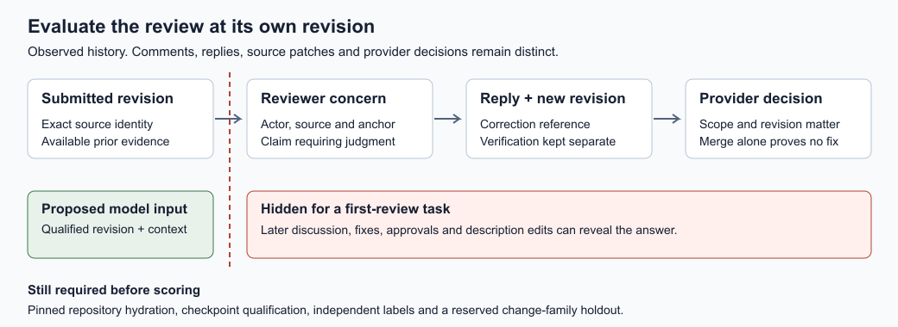

# PR Bench research dataset

Collected on 2026-10-06 at the user's request. This development corpus has **22 selected review cases and three retained selection controls across eight projects**, with 487 inline comments, 240 explicit inline replies, 329 currently visible GitHub commits and 31 Gerrit patchsets. Counts include controls. Accounts are attributed using provider metadata; a GitHub `User` account is not proof of unaided human authorship.

The dataset preserves how contributors disclose work, reviewers investigate concerns and discussions change across revisions. It is research input for the review-quality experiment (NEU-14), not an independently adjudicated benchmark or an approved production policy. Every case is exposed development material. No blind holdout or scored model result is claimed.

## Read and use the dataset

| Artifact                                                                                        | Purpose                                                                                                                                                                |
| ----------------------------------------------------------------------------------------------- | ---------------------------------------------------------------------------------------------------------------------------------------------------------------------- |
| Case index (kept in the private archive)                                                                       | One machine-readable row per capture, with provider, source revision, discussion counts, selection status and raw/annotation locations.                                |
| UI annotations (kept in the private archive) and systems annotations (kept in the private archive) | Source-linked findings, contributor disclosures, selection reasons, actors and unresolved evidence.                                                                    |
| Raw captures (kept in the private archive)                                                                            | Original API bodies, discussion text, review anchors, per-commit patches, Gerrit patchsets, current resolution snapshots where captured and endpoint-level provenance. |
| [Benchmark survey](benchmarks.md) and [structured catalogue](benchmarks.json)                   | Twelve benchmark entries, distinguishing inputs, reference judgments, release versions, availability and limitations.                                                  |
| [Evaluation protocol](protocol.md)                                                              | Proposed replay tasks, temporal restrictions, qualification, controls and metrics.                                                                                     |
| Integrity inventory and verifier (both kept in the private archive)                                  | SHA-256 and byte checks with source/index consistency checks. Integrity does not establish semantic correctness.                                                       |
| Search talk notes (kept in the private archive)                              | Timestamped paraphrases and the publisher's complete transcript link. Reproduction permission was not established, so no full transcript was copied.                   |

The diagram was rendered from the [accessible SVG source](review-flow.svg) and visually inspected. The important distinction is the evidence available at the revision being judged. The final patch and complete discussion belong in the research export, but cannot all appear in a first-review model input.

## Selected review cases

| Project                             | Selected cases and why they matter                                                                                                                                                                                                                                                                                                                                                                                                                                                                                                                     |
| ----------------------------------- | ------------------------------------------------------------------------------------------------------------------------------------------------------------------------------------------------------------------------------------------------------------------------------------------------------------------------------------------------------------------------------------------------------------------------------------------------------------------------------------------------------------------------------------------------------ |
| react-three-fiber                   | [Renderer lifecycle](https://github.com/pmndrs/react-three-fiber/pull/1717), [test-renderer API semantics](https://github.com/pmndrs/react-three-fiber/pull/1977), [dashed prop resolution](https://github.com/pmndrs/react-three-fiber/pull/3576). Questions uncover actual use cases and different interpretations of an API.                                                                                                                                                                                                                        |
| shadcn/ui                           | [Toast interaction](https://github.com/shadcn-ui/ui/pull/32), [breadcrumb composition](https://github.com/shadcn-ui/ui/pull/133), [cmdk compatibility](https://github.com/shadcn-ui/ui/pull/2945). Review connects component behavior, examples and compatibility assumptions.                                                                                                                                                                                                                                                                         |
| Radix                               | [Hidden-item focus](https://github.com/radix-ui/primitives/pull/618), [submenu interaction](https://github.com/radix-ui/primitives/pull/627). Experiments and discussion revise initial assumptions about focus, memoization and pointer behavior.                                                                                                                                                                                                                                                                                                     |
| Vite                                | [Transport API](https://github.com/vitejs/vite/pull/18362), [unmerged CSS Modules proposal](https://github.com/vitejs/vite/pull/16018). Exact correction links and before/after examples reduce reviewer reconstruction; closure can still preserve useful design judgment.                                                                                                                                                                                                                                                                            |
| VS Code                             | [Disassembly editor](https://github.com/microsoft/vscode/pull/125737). Review crosses behavior, accessibility, resource disposal and product integration.                                                                                                                                                                                                                                                                                                                                                                                              |
| Chrome DevTools MCP                 | [Mock-test migration](https://github.com/ChromeDevTools/chrome-devtools-mcp/pull/2641), [filesystem roots](https://github.com/ChromeDevTools/chrome-devtools-mcp/pull/2605), [unrestricted paths](https://github.com/ChromeDevTools/chrome-devtools-mcp/pull/2296), [superseded source-location work](https://github.com/ChromeDevTools/chrome-devtools-mcp/pull/2060). Review challenges test ownership, disclosure, configuration semantics and stale work.                                                                                          |
| Entire CLI                          | [The user's search-skill exemplar](https://github.com/entireio/cli/pull/2198), [serialized ref updates](https://github.com/entireio/cli/pull/2211), [hook roots](https://github.com/entireio/cli/pull/2052). Distinct concerns connect to corrective commits, accepted limitations and filesystem/state ownership.                                                                                                                                                                                                                                     |
| DevTools Frontend, canonical Gerrit | [Prompt selection across tabs](https://chromium-review.googlesource.com/c/devtools/devtools-frontend/+/8494474), [Lit source frame](https://chromium-review.googlesource.com/c/devtools/devtools-frontend/+/8495763), [pseudo-element selector tests](https://chromium-review.googlesource.com/c/devtools/devtools-frontend/+/8520559), [reviewable memory-leak reland](https://chromium-review.googlesource.com/c/devtools/devtools-frontend/+/8511660). Patchsets expose revision-specific reasoning. The GitHub mirror is not the review authority. |

Three retained controls explain why comment volume alone is inadequate. [Shadcn prefix support](https://github.com/shadcn-ui/ui/pull/770) is supplemental because adoption requests dominate. [MCP redirect-policy work](https://github.com/ChromeDevTools/chrome-devtools-mcp/pull/2503) lacks substantive contributor follow-up. [A Gerrit HAR URL change](https://chromium-review.googlesource.com/c/devtools/devtools-frontend/+/8496184) has many patchsets but little substantive discussion. These are selection controls, not proven defect-free changes.

## Impressions and proposed product experiments

The recurring useful pattern is a reviewer making an assumption explicit, an author responding with a precise source change, and both parties retaining what still needs evidence. Merging is only the last provider event. The discussion explains much more about review quality than that event alone.

| Neuve area                          | Observed evidence                                                                                                                                                                              | Proposed experiment                                                                                                                                                                                              |
| ----------------------------------- | ---------------------------------------------------------------------------------------------------------------------------------------------------------------------------------------------- | ---------------------------------------------------------------------------------------------------------------------------------------------------------------------------------------------------------------- |
| Harness                             | [Entire's lock repair](https://github.com/entireio/cli/pull/2211) attracts new concerns across revisions.                                                                                      | Replay each revision; measure detection of remaining concerns and avoid repeating concerns independently shown corrected. Retain tool calls and executable receipts separately.                                  |
| Retrieval                           | [Vite's transport concern](https://github.com/vitejs/vite/pull/18362#discussion_r1804556526) depends on pending promise behavior beyond an interface change.                                   | Judge whether the correct callers, lifecycle contracts and prior rationale were found at the right revision. Score missing and wrong attribution separately.                                                     |
| Embeddings                          | [Dashed props](https://github.com/pmndrs/react-three-fiber/pull/3576#issuecomment-3247041281) have several meanings behind similar wording.                                                    | Use confusing near matches and differently worded related concerns. Similarity should help discovery while preserving source and version identity.                                                               |
| Ingestion and enrichment            | [MCP roots advice changes within a thread](https://github.com/ChromeDevTools/chrome-devtools-mcp/pull/2605#discussion_r3835471706). Some review-named commits disappear from current PR lists. | Retain explicit replies, original anchors, revision references, contradictory advice and unavailable-source observations. Verify inferred concern-to-fix links rather than deriving them from nearby timestamps. |
| Reviewer skills                     | [MCP mock review](https://github.com/ChromeDevTools/chrome-devtools-mcp/pull/2641#discussion_r3917755926) rejects simulated business behavior as proof.                                        | Challenge the premise, test ownership and realistic failure path. Include unsupported suggestions and unresolved disagreements so finding volume cannot win.                                                     |
| Contextual briefing and review desk | [The DevTools reland](https://chromium-review.googlesource.com/c/devtools/devtools-frontend/+/8511660) changes presentation to make revision comparison possible.                              | Measure whether concise explanation and progressive disclosure let a reviewer reach a supported decision with fewer repeated lookups. Preserve the existing UI design.                                           |
| Records and lineage                 | [Entire's exemplar](https://github.com/entireio/cli/pull/2198) separates correction references, telemetry limitations and revision-specific approval.                                          | Retrieve the original concern, author response, correction and applicable disposition without treating a reply or resolved thread as approval. External discussion rounds do not define Neuve cycles.            |

Useful contributor disclosure explains the concrete old/new behavior, actual scenario, affected contracts, alternatives, material remaining limits and evidence. [Vite's contributor reply](https://github.com/vitejs/vite/pull/18362#discussion_r1806038538) supplies an exact correction link. [Shadcn's narrowed compatibility scope](https://github.com/shadcn-ui/ui/pull/2945#issuecomment-1995164689) makes an overgeneralization visible. These patterns serve the established [reviewer's-tax principle](../../foundations/05-reviewers-tax.md) by reducing reconstruction while preserving uncertainty. They are candidates for disclosure evaluation, not a universal PR template.

## What remains before scored evaluation

The corpus contains full discussion captures and patches, not hydrated executable repositories. Four review-named VS Code commits could not be recovered. Force-pushed/deleted history and final-description edits can prevent exact temporal reconstruction. GitHub collections have API limits; externally linked CI, screenshots and demos remain references unless separately captured. Some current thread states are captured only for systems cases. Per-case manifests retain these limits.

The strongest methods to borrow are multi-round state tracking, versioned context experiments, independently checked findings, supported negative controls and executable correction checks. The [benchmark survey](benchmarks.md) distinguishes these mechanisms from leaderboard claims. It also retains a directly observed MCR-Bench JSONL ingestion defect and conflicting release counts. No benchmark results were reproduced.

Next, independently qualify a small set of complete revision checkpoints, annotate necessary evidence and concern states, and reserve new whole change families. Freeze the inputs and assessor criteria through the existing candidate gate (NEU-24) before matched scoring. This collection does not change those gates or [established product meanings](../../vocabulary.md).

The capture verifier and the index builder are kept in the private archive with the captures. The verifier checks the retained bytes. The index builder derives the index from the captures; it rewrites the inventory, so it is an authoring step, not verification. Preserve old exports before recollecting or freezing a new version. Public code licenses and discussion/media reuse rights remain separate; this local collection is not an externally cleared release.
